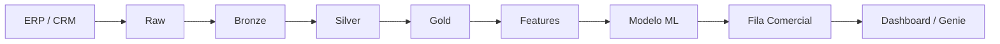

# Rota Perfume — Plataforma de Dados e Inteligência Comercial

## Visão geral

Rota Perfume é um projeto pessoal e profissional de engenharia de dados e inteligência comercial para uma distribuidora B2B de perfumaria árabe. A solução integra dez arquivos provenientes de ERP e CRM, preserva a rastreabilidade dos dados de origem, aplica qualidade e modelagem em arquitetura medalhão e disponibiliza informação pronta para decisão.

O fluxo transforma dados transacionais, cadastrais, financeiros, comerciais e de estoque em análises governadas, um modelo de propensão de compra e uma fila semanal acionável. O resultado conecta engenharia de dados, machine learning e consumo de negócio no mesmo lakehouse: a equipe comercial recebe clientes priorizados, o motivo do contato e uma sugestão de produto apoiada pelo histórico de compra e pelo estoque mais recente.

## Problema de negócio

A pergunta central é objetiva: **entre aproximadamente 3.000 clientes, quais 200 devem receber contato comercial na semana?**

Uma seleção baseada apenas em recência ou valor histórico desperdiça capacidade comercial e pode ignorar sinais relevantes. O projeto combina comportamento de compra, ritmo individual, interações no CRM e diversidade do mix para estimar a propensão de compra de cada cliente. Antes do corte dos 200, são mantidos apenas clientes com carteira vigente e vendedor elegível; depois, a fila é organizada por vendedor e enriquecida com contexto para a abordagem.

## Arquitetura



O Databricks Asset Bundle reúne schemas, volume, job, dashboard e Genie como recursos versionáveis. O Lakeflow Job `rotaperfume_pipeline` orquestra as transformações em compute serverless, enquanto o Databricks SQL Warehouse executa as tarefas SQL e sustenta o consumo analítico.

## Arquitetura Medalhão

- **Raw:** área de chegada no volume gerenciado `bronze.raw`, com os dez CSVs originais de ERP e CRM. A conferência valida presença, tamanho e quantidade de linhas antes da ingestão.
- **Bronze:** cópia fiel dos arquivos em tabelas Delta. Todas as colunas de origem permanecem como `STRING`; apenas `_ingerido_em` e `_arquivo_origem` são adicionadas.
- **Silver:** camada tipada, normalizada e validada. Trata datas em formatos mistos, CNPJs, duplicidade de clientes, cancelamentos, devoluções, carteiras órfãs e regras de integridade.
- **Gold:** modelo dimensional e objetos de consumo. Reúne dimensões conformadas, fato de vendas, marts, views de negócio, features, scores, métricas do modelo e fila comercial.

## Tecnologias

- Databricks
- Databricks Asset Bundles
- Apache Spark/PySpark
- Spark SQL
- Delta Lake
- Unity Catalog
- Lakeflow Jobs
- Databricks SQL Warehouse
- MLflow
- scikit-learn
- Python
- YAML
- Bash
- Genie
- Lakeview Dashboards
- Git e GitHub
- PostgreSQL
- FastAPI
- Docker
- GitHub Actions

## Estrutura do repositório

```text
DataEngineeringParfum/
├── README.md
├── dados/
│   ├── crm/                         # 5 arquivos CSV do CRM
│   └── erp/                         # 5 arquivos CSV do ERP
├── dashboards/
│   └── dataegineering-parfum.lvdash.json  # Dashboard final (cópia de segurança, fora do bundle)
├── servico/                         # Camada de serviço: carga para PostgreSQL e API FastAPI
│   ├── app/                         # API FastAPI somente leitura
│   ├── carga/                       # Carregador Databricks para PostgreSQL
│   ├── docs/                        # Decisões de projeto e guia de operação
│   └── README.md
└── dataengineering_parfum/
    ├── databricks.yml               # Bundle, variáveis e targets
    ├── resources/
    │   ├── catalogo.yml             # Schemas e volume Raw
    │   ├── pipeline.job.yml         # DAG com 15 tarefas
    │   ├── dashboard.dashboard.yml  # Recurso Lakeview
    │   ├── dashboard-comercial.lvdash.json
    │   ├── genie.genie_space.yml    # Recurso Genie
    │   └── comercial.geniespace.json
    ├── scripts/
    │   ├── criar-catalogo.sh
    │   ├── subir-raw.sh
    │   ├── rodar-tarefa.sh
    │   └── run_sql.py
    ├── src/
    │   ├── raw/                     # Conferência dos arquivos de chegada
    │   ├── bronze/                  # Ingestão fiel dos CSVs em Delta
    │   ├── silver/                  # Limpeza, tipagem e contratos
    │   ├── gold/                    # Dimensões, fato, marts e governança
    │   └── ml/                      # Features, modelo, score e fila
    └── tests/                       # Testes com pytest e Databricks Connect
```

## Pipeline

O arquivo `dataengineering_parfum/resources/pipeline.job.yml` define as 15 tarefas abaixo. A ordem da tabela acompanha a definição do recurso; a coluna de dependências explicita a execução efetiva do DAG.

| # | Tarefa | Implementação | Depende de |
|---:|---|---|---|
| 1 | `raw_conferencia` | `dataengineering_parfum/src/raw/conferencia.py` | — |
| 2 | `bronze_ingestao` | `dataengineering_parfum/src/bronze/ingestao.py` | `raw_conferencia` |
| 3 | `silver_clientes` | `dataengineering_parfum/src/silver/01-clientes.sql` | `bronze_ingestao` |
| 4 | `silver_pedidos` | `dataengineering_parfum/src/silver/02-pedidos.sql` | `bronze_ingestao` |
| 5 | `silver_itens_produtos` | `dataengineering_parfum/src/silver/03-itens-e-produtos.sql` | `bronze_ingestao` |
| 6 | `silver_crm_financeiro` | `dataengineering_parfum/src/silver/04-crm-e-financeiro.sql` | `bronze_ingestao` |
| 7 | `gold_dimensoes` | `dataengineering_parfum/src/gold/05-dimensoes.sql` | as quatro tarefas Silver |
| 8 | `gold_fato_vendas` | `dataengineering_parfum/src/gold/06-fato-vendas.sql` | `gold_dimensoes` |
| 9 | `gold_marts` | `dataengineering_parfum/src/gold/07-marts.sql` | `gold_fato_vendas` |
| 10 | `metricas_de_negocio` | `dataengineering_parfum/src/gold/09-metricas-negocio.sql` | `gold_marts` |
| 11 | `auditoria_de_metadado` | `dataengineering_parfum/src/gold/10-auditoria-metadado.sql` | `metricas_de_negocio` |
| 12 | `testes` | `dataengineering_parfum/src/gold/08-testes.sql` | `gold_marts` |
| 13 | `ml_features` | `dataengineering_parfum/src/ml/11-features.py` | `testes` |
| 14 | `ml_modelo` | `dataengineering_parfum/src/ml/12-modelo.py` | `ml_features` |
| 15 | `ml_fila` | `dataengineering_parfum/src/ml/13-fila.sql` | `ml_modelo` |

As tarefas `silver_clientes`, `silver_pedidos`, `silver_itens_produtos` e `silver_crm_financeiro` são executadas em paralelo após a Bronze. Depois de `gold_marts`, o DAG abre dois ramos: `metricas_de_negocio → auditoria_de_metadado` e `testes → ml_features → ml_modelo → ml_fila`.

## Camadas e principais entregas

### Raw

Os arquivos são armazenados em `/Volumes/<catalog>/bronze/raw/{erp,crm}`.

| Origem | Arquivos |
|---|---|
| ERP | `produtos.csv`, `pedidos.csv`, `itens_pedido.csv`, `pagamentos.csv`, `estoque.csv` |
| CRM | `clientes.csv`, `vendedores.csv`, `carteira.csv`, `oportunidades.csv`, `visitas.csv` |

A tabela de controle `bronze._raw_arquivos` mantém sistema, arquivo, tamanho, linhas e instante da conferência.

### Bronze

As dez tabelas Delta reproduzem os arquivos de origem sem limpeza ou conversão:

- ERP: `bronze.produtos`, `bronze.pedidos`, `bronze.itens_pedido`, `bronze.pagamentos` e `bronze.estoque`.
- CRM: `bronze.clientes`, `bronze.vendedores`, `bronze.carteira`, `bronze.oportunidades` e `bronze.visitas`.

### Silver

As tabelas `silver.clientes`, `silver.pedidos`, `silver.produtos`, `silver.itens_pedido`, `silver.vendedores`, `silver.carteira`, `silver.oportunidades`, `silver.visitas`, `silver.pagamentos` e `silver.estoque` formam a camada limpa e tipada.

Entre as regras aplicadas estão a deduplicação de clientes por CNPJ com preservação dos IDs descartados, o tratamento de datas em dois formatos, a identificação de cancelamentos e devoluções, a validação de carteiras vigentes e o recálculo de ruptura a partir do saldo.

### Gold

- **Dimensões:** `gold.dim_cliente`, `gold.dim_produto`, `gold.dim_vendedor` e `gold.dim_calendario`.
- **Fato:** `gold.fato_vendas`, no grão de item de pedido, particionada por ano e mês. Pedidos cancelados são excluídos; devoluções permanecem com quantidade, receita e custo negativos.
- **Marts:** `gold.mart_vendas_por_vendedor`, `gold.mart_produto_performance` e `gold.mart_financeiro_recebimento`.
- **Views comerciais:** `gold.receita_mensal`, `gold.ranking_marcas`, `gold.margem_por_categoria`, `gold.clientes_em_risco`, `gold.efeito_lancamento` e `gold.ruptura_por_marca`.

### ML e ativação comercial

- `gold.features_treino`: uma linha por cliente no corte histórico, com o alvo `comprou_em_7d`.
- `gold.features_cliente`: uma linha por cliente no corte de pontuação, sem o alvo.
- `gold.score_propensao`: probabilidade, faixa comercial, referência e versão do modelo por cliente.
- `gold.modelo_metricas`: histórico de AUC, lift top 200, acertos, taxa base, baselines e principal feature.
- `gold.calibragem_holdout`: volume, compras observadas, taxa de compra e score médio por faixa no holdout.
- `gold.fila_semanal`: os 200 contatos priorizados, com vendedor, ordem, score, motivo e sugestão de produto.
- Modelo registrado: `gold.propensao_compra`, governado no Unity Catalog e consumido pelo alias `@prod`.

Quatro funções SQL apoiam a preparação e a execução dos contatos:

- `gold.priorizar_carteira(p_vendedor, p_quantos)`: retorna a fila ordenada de um vendedor.
- `gold.contexto_cliente(p_cliente_id)`: resume histórico, ticket médio e marcas preferidas.
- `gold.sugerir_produtos(p_cliente_id)`: lista itens comprados no passado e sem recompra recente, com estoque atual.
- `gold.checar_disponibilidade(p_sku)`: consulta saldo e ruptura no snapshot mais recente.

## Machine Learning

O conjunto de modelagem contém 20 variáveis organizadas em quatro grupos:

- **RFM:** `recencia_dias`, `frequencia_pedidos`, `valor_total`, `ticket_medio`, `margem_total` e `margem_percentual`.
- **Ritmo:** `intervalo_medio_dias`, `desvio_intervalo_dias`, `atraso_relativo` e `pedidos_ultimos_90d`.
- **CRM:** `oportunidades_abertas`, `oportunidades_ganhas`, `taxa_ganho`, `visitas_90d` e `conversao_visita`.
- **Mix:** `skus_distintos`, `categorias_distintas`, `marcas_distintas`, `concentracao_marca_top` e `comprou_lancamento`.

A prevenção de vazamento temporal começa na leitura: vendas, oportunidades e visitas são filtradas para eventos estritamente anteriores à data de referência. O treino usa o corte de 1º de agosto de 2026 e um alvo de compra nos sete dias seguintes; o score usa o corte de 31 de agosto de 2026. Agregados de cliente calculados sobre todo o período não entram nas features.

O modelo é um `HistGradientBoostingClassifier`, que preserva os valores ausentes intencionais das features de ritmo. Seu AUC no holdout estratificado é comparado a três baselines — recência, valor total e atraso relativo — e o `lift_top200` é calculado com probabilidades out-of-fold em validação cruzada estratificada de cinco partes.

Parâmetros, métricas e artefato são registrados no MLflow. O modelo final é publicado no registro de modelos do Unity Catalog, e o alias móvel `@prod` aponta para a versão utilizada no score.

A reprodutibilidade é garantida por `random_state=42`, ordenação prévia por `cliente_id` e desempates determinísticos. O top 200 out-of-fold usa score decrescente e `cliente_id` crescente; o score, as faixas e a fila comercial repetem a mesma regra de desempate.

## Resultados validados

| Indicador | Resultado |
|---|---:|
| Arquivos Raw conferidos | 10 |
| Linhas ingeridas na Bronze | 313.551 |
| Itens em `gold.fato_vendas` | 191.080 |
| Receita total reconciliada | R$ 102.303.828,05 |
| Clientes em `gold.features_treino` | 2.815 |
| Clientes em `gold.features_cliente` para score | 2.816 |
| AUC no holdout | 0,8739 |
| Lift top 200 | 4,2966× |
| Acertos entre os 200 priorizados | 87 |
| Clientes em `gold.fila_semanal` | 200 |
| Vendedores representados na fila | 35 |
| Execução do pipeline | 15/15 tarefas `SUCCESS` |

## Qualidade e governança

A qualidade é bloqueante: uma regra reprovada interrompe o job antes do consumo comercial. O projeto implementa:

- conferência dos dez arquivos Raw e reconciliação de suas contagens com a Bronze;
- constraints Silver para CNPJ, datas obrigatórias, cancelamentos e quantidade de itens;
- nove testes SQL sobre receita, unicidade, nulidade, devoluções, volume e integridade referencial;
- reconciliação da receita entre Silver, `gold.fato_vendas` e o mart de produtos, com tolerância de R$ 0,01;
- validações das datas de referência e das contagens de clientes nas tabelas de features;
- testes do modelo contra o melhor baseline, limite superior de AUC e lift mínimo;
- testes da fila para volume exato, motivo preenchido e score no intervalo de zero a um;
- comentários de negócio em tabelas, views, colunas críticas e funções no Unity Catalog;
- auditoria bloqueante via `information_schema`, além de relatório de cobertura de metadados.

## Dashboard e Genie

O Lakeview Dashboard `Rota Perfume - Dashboard Comercial` possui duas páginas:

- **Visão Comercial:** filtros por ano, segmento e cidade; KPIs de receita total, margem total, número de pedidos e ticket médio; receita mensal em 24 meses; top 10 marcas; margem percentual por categoria; receita por canal; e top 20 clientes.
- **Fila da semana:** filtro por vendedor e tabela de contatos priorizados com ordem, cliente, cidade, score, faixa, motivo e sugestão.

O Genie Comercial é configurado como código e consulta 13 objetos governados da Gold, incluindo as seis views de negócio, dimensões, fato de vendas, score de propensão e fila semanal. Suas instruções definem glossário, sazonalidade, cálculos e fontes preferenciais, além de exemplos de perguntas e SQL validados.

O dashboard final foi criado e publicado no Databricks com o assistente Genie, consolidando visualizações executivas e exploração dos dados em linguagem natural sobre os mesmos objetos governados.

A definição desse dashboard está versionada em `dashboards/dataegineering-parfum.lvdash.json`, como cópia de segurança: ele vive só no workspace, fora do bundle, e lê o Gold ao vivo.

## Camada de serviço

A pasta `servico/` leva os resultados do Gold para fora do Databricks: um carregador copia as tabelas para um PostgreSQL
local, e uma API FastAPI somente leitura entrega ao vendedor a fila da semana, o contexto de cada cliente, os produtos
sugeridos e a disponibilidade em estoque. Tem Docker, integração contínua no GitHub Actions e testes contra um PostgreSQL
de verdade.

Fluxo: `Gold (Databricks) → carga → PostgreSQL → API FastAPI`.

- Como montar e usar: [`servico/README.md`](servico/README.md).
- Por que foi desenhada assim, com o que foi descartado: [`servico/docs/decisoes.md`](servico/docs/decisoes.md).
- Operação e limitações conhecidas: [`servico/docs/operacao.md`](servico/docs/operacao.md).

## Como executar

Execute os comandos a partir da raiz do repositório e escolha explicitamente um profile Databricks autenticado:

```bash
cd dataengineering_parfum
databricks bundle validate --target dev --profile <PROFILE>
databricks bundle deploy --target dev --profile <PROFILE>
databricks bundle run rotaperfume_pipeline --target dev --profile <PROFILE>
```

Para executar isoladamente as tarefas de ML:

```bash
bash scripts/rodar-tarefa.sh <PROFILE> ml_features
bash scripts/rodar-tarefa.sh <PROFILE> ml_modelo
bash scripts/rodar-tarefa.sh <PROFILE> ml_fila
```

O catálogo, os schemas, o volume Raw e os arquivos de origem devem estar disponíveis antes da execução do pipeline.

## Requisitos

- Databricks CLI instalado e autenticado.
- Workspace Databricks com Unity Catalog habilitado.
- Databricks SQL Warehouse serverless disponível.
- Permissões para criar e gerenciar os recursos definidos no bundle.
- Um profile selecionado explicitamente em cada comando da CLI.

## Autor

Rian Maia de Freitas.
